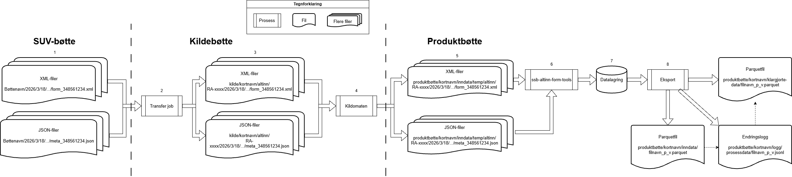

::: {.callout-warning}
## Dette er ikke grundig testet

Vi tror og håper at dette opplegget skal fungere og være lett å ta i bruk for alle som har en Altinn3 undersøkelse på Dapla.
Det er testet på en del skjemaer og ser ut til å fungere, men vi ønsker gjerne tilbakemeldinger og forbedringsforslag, for vi kan fort ha oversett noe.

Ta gjerne kontakt med Magnus Theodor Engh eller Didrik Boe-Tangen om du har noen spørsmål eller forslag!

Denne meldingen fjernes når vi føler oss trygge på at opplegget er produksjonsklart.
:::

## Hva er startpakken?

Ledestjernen til denne malen er at det skal være en fornuftig standardkonfigurasjon av det man trenger for å jobbe med altinn3 på Dapla og skape et felles utgangspunkt. Dette utgangspunktet mener vi tilrettelegger for fremtidig optimalisering av arbeidsprosessen og øker mulighetene for å dele kode og erfaringer på tvers av undersøkelser. I tillegg til at det sparer deg for å lese masse teknisk dokumentasjon bare for å finne ut hvordan ting burde se ut.

Altinn3 på Dapla startpakke er et konsept som syr sammen eksisterende funksjonaliteter på en måte som gjør det lett å hente inn et ferdig oppsett for å jobbe med Altinn3-undersøkelser på Dapla i et eksisterende ssb-project repo. 

Det startpakken tilbyr er et ferdig montert utgangspunkt så mengden systemer du må forholde deg til som statistikkansvarlig holdes til et minimum og hvor mest mulig er valgfritt og mulig å tilpasse.

Over tid regner vi med at verktøykassen utvides, og siden vi har en mal så vil det være mulig å legge til mer av disse fremtidige verktøyene i malen.

Planen er at du enkelt kan legge til nye verktøy i ditt repository med en kommando, fremfor å måtte lese gjennom dokumentasjon og finne veien selv.

Er du interessert i detaljer kan du se litt lenger ned i artikkelen.

## Hvordan tar jeg i bruk startpakken?

For å sette opp systemet må du gjøre endringer i ditt repository og sette opp litt i google cloud.

### I repositoriet ditt

**Det første steget** er å åpne en terminal og kjøre kommandoen nedenfor.

```{.bash filename="terminal"}
cruft update --checkout=e88ecba --variables-to-update '{"altinn": true}'
```

Dette vil gjøre en cruft update, som oppdaterer ditt repo med en ny versjon av det ssb-project create lager, hvor vi også endrer en variabel (altinn settes til true). Fordelen med å bruke et verktøy som cruft er at vi kan sentralt vedlikeholde den felles biten av malen, uten at hver enkelt må følge med på detaljer som endres.

::: {.callout-warning}
## Utdatert ssb-project mal

Har du en utdatert versjon av ssb-project malen så blir det litt mer jobb siden du må oppdatere til en oppdatert mal i tillegg til at altinn startpakke legges inn.

Støtteteamene kan bistå med oppdatering til ny mal.
:::

Etter du har oppdatert malen burde det ha dukket opp noen endringer i settings.toml og mappen `src/altinn/` med noen filer.

**Steg to** er at du åpner filen `config/settings.toml` og setter form_number til ditt skjemanummer.

Øvrig forklaring om hvordan malen er satt opp og hva du må/kan gjøre selv kan du se i `src/altinn/README.md` i ditt eget repo.

### I Google cloud

#### Flyten vi skal oppnå



1. [Datamottaket fra Altinn3 hos Suv](https://manual.dapla.ssb.no/statistikkere/altinn-oversikt.html#data)
2. [Transfer job til kildebøtte](https://manual.dapla.ssb.no/statistikkere/altinn-oversikt.html#transfer-service)
3. Uendrede XML- og JSON-filer kopiert fra datamottaket
4. Kildomat som overfører XML- og JSON-filene. Eksempelkode:

    ```python
    import gcsfs
    import logging

    logger = logging.getLogger(__name__)
    logger.setLevel(logging.INFO)

    fs = gcsfs.GCSFileSystem()

    destination_root = "Bøttenavn-her/kortnavn-her/inndata/altinn"

    def main(source_file):
        logger.info(f"Prosesserer: {source_file}")
        if source_file.endswith(".xml") or source_file.endswith(".json"):        
            relative_path = source_file.split("/altinn/", 1)[1]        
            dest = f"gs://{destination_root}/{relative_path}"
            logger.info(f"Kopierer {source_file} til {dest}")
            fs.copy(source_file, dest)
        else:
            logger.debug(f"Hopper over '{source_file}'")
    ```

5. XML- og JSON filer i produktbøtta. Standard utflatingskode i neste steg baserer seg på at man kjører den mot xml og json filer som de ble mottatt fra Altinn3.
6. Utflatingskode bygd på ssb-altinn-form-tools. Koden og forklaringer om den kan du finne i ditt repo (antatt at du har gjort stegene der) og i [ssb-altinn-form-tools sin dokumentasjon](https://github.com/statisticsnorway/ssb-altinn-form-tools)
7. Datalageret dataene ligger i under editeringsprosessen, standardvalget er [ParquEdit](https://manual.dapla.ssb.no/statistikkere/ssb-parquedit.html)
8. Eksport kode som trekker ut dataene. Skal resultere i 3 filer:
    - Parquetfil med rådata før endringer ble gjort under editeringsprosessen. Lagres som inndata
    - Parquetfil med data slik de ser ut etter editeringsprosessen. Lagres som klargjorte-data
    - Jsonl fil med endringsloggen for editeringsprosessen. Skal følge vedtatte standarder

::: {.callout-warning}
## OBS!

Startpakken antar at du tar vare på mappenavn og filstier som de mottas fra SUV-bøtta, det kan skape problemer om dette endres.

Filstien burde være "RA-xxxx/yyyy/mm/dd/.../form_267354.xml"
:::

## Ofte stilte spørsmål og vanlige problemer

::: {.callout-tip collapse="true"}
### Utflatingskoden passer ikke mine data

ssb-altinn-form-tools er bygd opp modulært og kan tilpasses, både i måten utflatingen gjøres og måten lagringen gjøres. Se [pakkens dokumentasjon](https://github.com/statisticsnorway/ssb-altinn-form-tools) eller kontakt støtteteam/tech coach for bistand.
:::

::: {.callout-tip collapse="true"}
### ParquEdit fungerer ikke

1. Du må sjekke i [Dapla Ctrl](https://dapla-ctrl.intern.ssb.no/) at ParquEdit er aktivert.
2. Du må sjekke at ParquEdit er slått på i Dapla Lab tjenesten din under Avansert -> ParquEdit
:::

## "Jeg er uenig med malen"

**Vi vil høre fra deg!**

Malen er ikke obligatorisk å bruke og forsøker å holde seg til et minimum, med fokus på å gi et fornuftig og felles utgangspunkt. Om du ønsker å gi tilbakemeldinger ta gjerne kontakt eller helst [lag et Issue på Github repositoriet for malen](https://github.com/statisticsnorway/ssb-project-template-stat/issues).

Vi forstår at det er en terskel å lage et issue, grunnen til at vi ønsker det er at det fungerer samlende for tilbakemeldinger og svar/beslutninger tilknyttet disse på et sted som er åpent for alle. Det gjør det også lettere å følge med på status for din tilbakemelding og se når det blir besvart.

**Vi ønsker heller at du gir tilbakemelding personlig enn at du lar være å gi beskjed** hvis å lage et issue oppleves som en for høy terskel.

