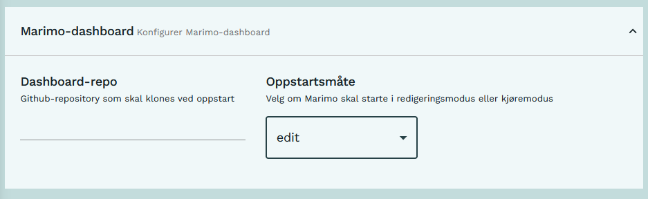
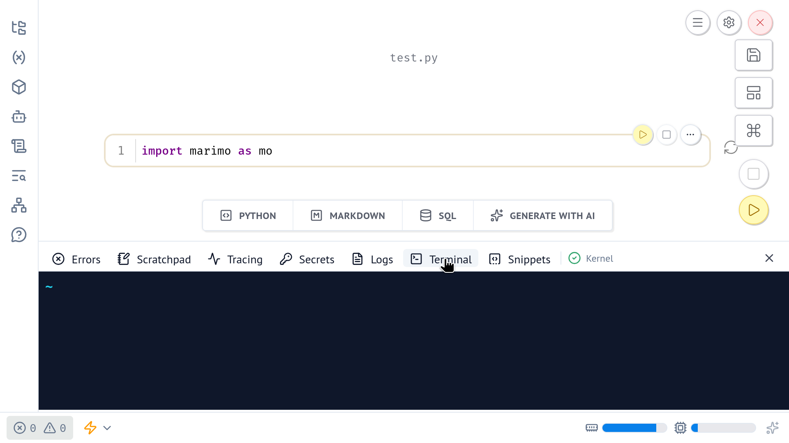
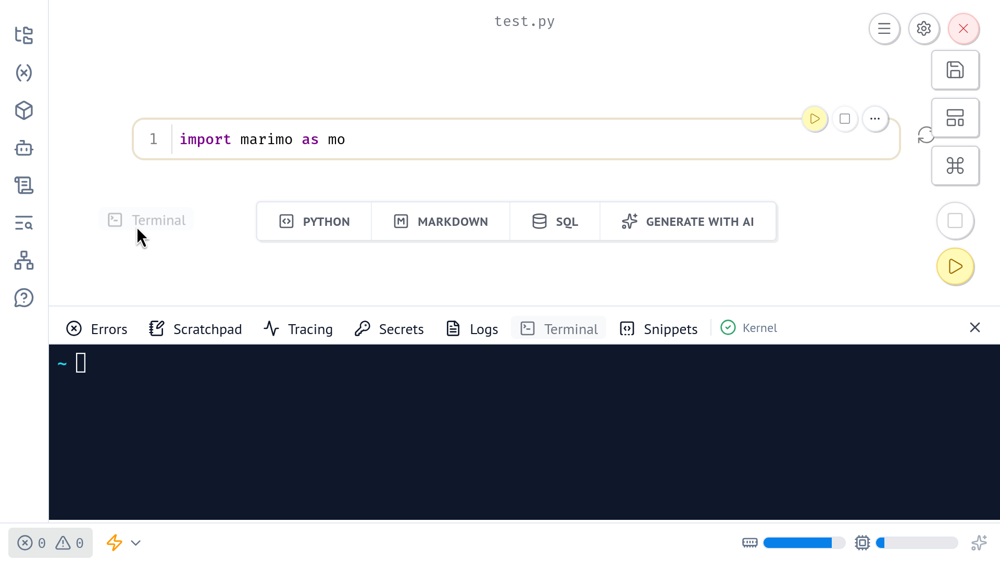
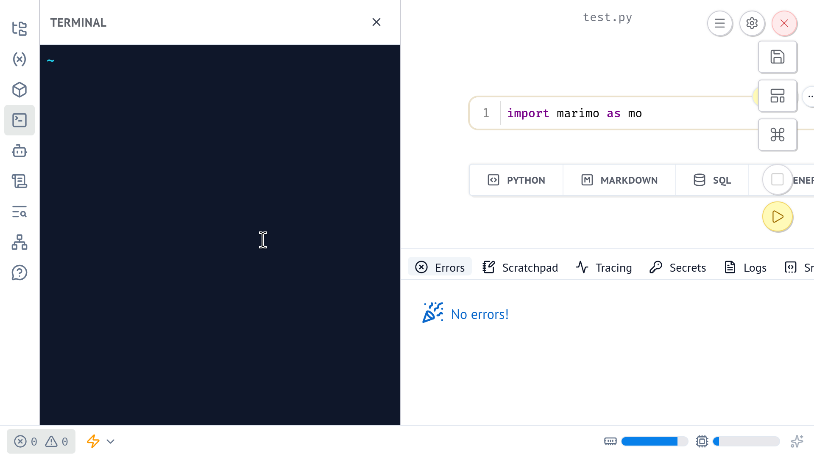
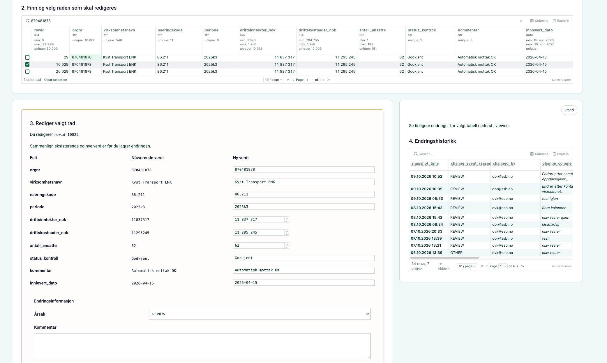
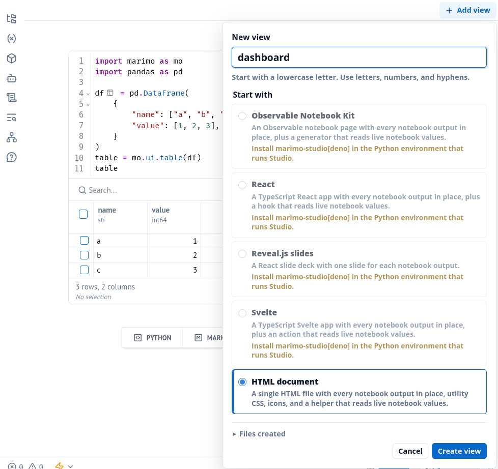
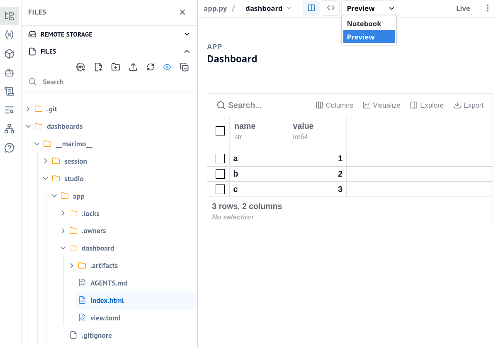
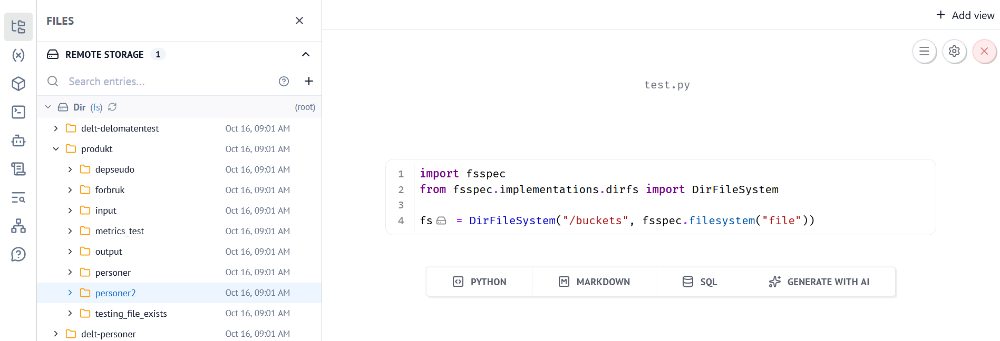
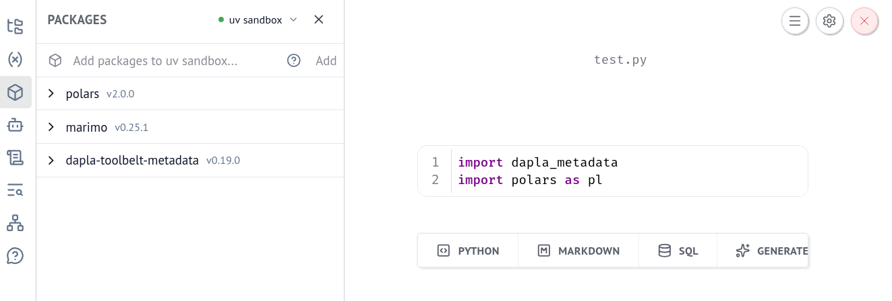

{style="max-width: 350%; float: right;" fig-alt="Marimo-dashboardtjenesten"}

**Marimo-dashboard** er en tjeneste på [Dapla Lab](./dapla-lab.qmd) som er skreddersydd for utvikling av dashboards og applikasjoner.
Tjenesten bygger på [Marimo](https://marimo.io/), som er et reaktivt Python-miljø med svært god støtte for brukerinteraksjon og dynamiske visualiseringer.

I tillegg kan man bruke [Marimo-studio](https://marimo-team.github.io/marimo-studio/), en utvidelse som gjør det lett å legge til form og stil ved hjelp av vanlig html og css.

## Bruksområde

Marimo-dashboard-tjenesten er egnet for å utvikle frittstående notebook-filer og åpne dem som selvstendige, interaktive applikasjoner.

Tjenesten benytter seg ikke av Python-prosjektet i repoet, men lager automatisk et isolert Python-miljø for hver notebook-fil.

Marimo er skreddersydd for utvikling av `Python` og `SQL`-kode, og støtter ikke `R`.

## Forberedelser

Før man starter **Marimo** bør man ha lest [kapitlet om Dapla Lab](./dapla-lab.qmd) og satt opp Git- og GitHub-konfigurasjonen under **Min konto**. Deretter gjør du følgende:

1. Logg deg inn på [Dapla Lab](https://lab.dapla.ssb.no/)
2. Under **Tjenestekatalog** trykker du på **Start**-knappen for **Marimo-studio**
3. Gi tjenesten et navn
4. Åpne **Marimo-dashboard konfigurasjoner**

## Konfigurasjon

Mye av konfigurasjonen for **Marimo-dasboards** er lik det som gjelder for [Jupyter](./jupyter.qmd#konfigurasjon). Det gjelder blant annet valg av team og tilgangsgruppe, Git/GitHub, ressurser, diskplass og avanserte valg som Parquedit-støtte.

Det viktigste er den delen som er spesifikt for Marimo-dashboard:

{style="max-width: 80%; margin: 1rem;" fig-alt="Konfigurasjon av Marimo-dashboard"}


### Oppstartsmåte

* *Edit*-modus brukes når man skal utvikle en notebook-fil, det vil si skrive kode i Marimo-grensesnittet. 
* *Run*-modus brukes når man vil kjøre en notebook-fil som en selvstendig applikasjon, uten å vise verken koden eller Marimo-grensesnittet. 

### Dashboard-repo

Man kan oppgi et GitHub-repo som skal klones ved oppstart av tjenesten.

Som konvensjon skal Github-repoet en mappe `dashboards/` på rotnivå.
Hva som forventes av repoet avhenger av oppstartsmåten:

* I edit-modus forventes ingenting av repoet. Man kan selv opprette `dashboards/`-mappen og nye notebook-filer første gang man starter tjenesten.
* I run-modus forventes en eksisterende `dashboards/`-mappe med én eller flere Marimo-notebooks. Notebook-filene kan organiseres fritt i undermapper.

Dersom feltet er tomt vil tjenesten åpne i `work/`-mappen og man kan selv klone eller opprette et nytt repo ved hjelp av terminalen.

## Funksjonalitet

### Edit-modus

I denne modusen åpnes hele Marimo-grensesnittet, slik at man kan utvikle og redigere notebook-filer direkte i nettleseren.

Marimo er rik på funksjoner og har et brukervennlig grensesnitt som man kan lese mer om [her](https://docs.marimo.io/guides/editor_features/).

For å bruke `git` (Github) og `opencode` (KI) må man bruke den integrerte terminalen i Marimo, som kan åpnes på følgende måte:

::: {.callout-note collapse="true"}
## Fremgangsmåte for å åpne terminal

::: {layout-ncol=2}

{group="marimo-terminal" fig-alt="Marimo med utviklerpanelet lukket og snarveien Ctrl J synlig."}

{group="marimo-terminal" fig-alt="Utviklerpanelet er åpnet med fanen Terminal valgt."}

{group="marimo-terminal" fig-alt="Terminalfanen er åpnet nederst i utviklerpanelet."}

{group="marimo-terminal" fig-alt="Terminalen er flyttet til venstre sidemeny i Marimo."}

:::
:::

### Run-modus

Dette passer når man allerede har laget en ferdig notebook-fil som skal vises som et brukergrensesnitt, for eksempel for utforsking av data eller deling av resultater internt i et team.

Hvis målet er å utvikle selve filen, er det normalt best å starte i edit-modus. Før man bruker run-modus er det lurt å sjekke at notebooken lar seg kjøre i edit-modus.

### Marimo-studio

Marimo-studio er en utvidelse til Marimo som kan brukes hvis man ønsker mer kontroll på utseendet til applikasjonen gjennom vanlig html og css:

{style="max-width: 80%; margin: 1rem;" fig-alt="Tabell i Parqueditor"}

For å ta i bruk Marimo-studio starter man tjenesten i edit-modus og følger disse stegene:

1. Åpne en eksisterende notebook-fil i `dashboards/`-mappen, eller opprett en ny notebook-fil.

2. Klikk på "Add view" øverst til høyre, gi ønsket navn, velg "HTML document" og trykk "Create view".

::: {.callout-note collapse="true" title="Skjermbilde"}
{style="max-width: 80%; margin: 1rem;" fig-alt="Dialogboksen Add view i Marimo Studio"}
:::

3. Du vil nå ha fått opprettet flere filer og får valget om å se en forhåndsvisning av viewet.

::: {.callout-note collapse="true" title="Skjermbilde"}
{style="max-width: 80%; margin: 1rem;" fig-alt="Forhåndsvisning av et view i Marimo Studio"}
:::

Legg merke til de nye filene og spesielt `index.html` der viewet ligger.
Det anbefales å sjekke inn disse filene til Github.
Pass imidlertid på at du ikke sjekker inn data knyttet til selve Marimo-sesjonen.
Anbefalt tillegg til `.gitignore` er:

```
__marimo__/session/
```

## Data og Git/GitHub

Marimo følger samme mønster som de andre utviklingstjenestene i Dapla Lab:

1. Datatilgang styres av hvilket team og hvilken tilgangsgruppe du velger.
2. Teamets bøtter blir tilgjengelige i filsystemet under `/buckets/`.
3. Git-bruker, e-post og GitHub-token kan arves fra **Min konto** i Dapla Lab.

For detaljer om datatilgang, delt-bøtter, Git/GitHub, ressurser, diskplass og oppstartsskript, se [Jupyter-kapitlet](./jupyter.qmd#konfigurasjon).

## Datatilgang

Dersom man ønsker å utforske filene i `/buckets` kan man kjøre en kodecelle med følgende innhold:

```py
import fsspec
from fsspec.implementations.dirfs import DirFileSystem

fs = DirFileSystem("/buckets", fsspec.filesystem("file"))
```

Deretter åpner man Marimos filutforsker i sidemenyen.
Fanen "Remote storage" vil vise innholdet i `/buckets`:

{style="max-width: 80%; margin: 1rem;" fig-alt="Vise innhold i buckets"}

Merk at Marimo-grensesnittet ikke har innebygd støtte for å åpne datafiler. Man kan imidlertid enkelt utvikle applikasjoner med både filutforsker og datavisning:

::: {.callout-note collapse="true" title="Skjermbilde"}
{style="max-width: 80%; margin: 1rem;" fig-alt="Marimo filutforskerkomponent"}
:::

Filutforsker-komponenten kan opprettes med følgende kodecelle og konfigureres etter behov:
```py
import marimo as mo

file_browser = mo.ui.file_browser(
    initial_path="/buckets/",
    filetypes=["parquet"],
    selection_mode="file",
    multiple=False,
)
file_browser
```

Variabelen `file_browser` vil til enhver tid inneholde hvilken fil som er valgt av brukeren.
Denne kan brukes i en ny kodecelle, for eksempel til å vise dataene i en tabell-komponent:

```py

import polars as pl

selected_files = file_browser.value
if len(selected_files) > 0:
    df = pl.read_parquet(selected_files[0].path)
    output = mo.ui.table(df)
else:
    output = mo.md("Ingen fil er valgt.")
output
```

Applikasjonen vil følge vanlig tilgangsstyring, det vil si at den viser dataene til teamet man åpner tjenesten med.

## Installere pakker

Pakker installeres i selve notebooken ved hjelp av Marimo-grensesnittet:

{style="max-width: 80%; margin: 1rem;" fig-alt="Pakkeavhengigheter i Marimo"}

1. Pass på at du er i riktig notebook.
2. Klikk på boks-ikonet i sidemenyen for å se installerte pakker.
3. For å legge til flere pakker, skriv pakkenavnet i inputfeltet og trykk "Add".
4. For å legge til pakker med en spesifikk versjon, skriv for eksempel `dapla-toolbelt-metadata==0.19` og trykk "Add".

Hver notebook-fil vil ha sin egen liste av installerte pakker.
Når man ser på notebook-filen i en vanlig teksteditor eller på Github, vil pakkene være deklarert øverst i filen: 

::: {.callout-note collapse="true" title="`test.py`"}
```py
# /// script
# dependencies = [
#     "dapla-toolbelt-metadata==0.19.0",
#     "marimo",
#     "polars==2.0.0",
# ]
# requires-python = ">=3.14"
# ///

import marimo

__generated_with = "0.25.1"
app = marimo.App(width="medium")


@app.cell
def _():
    import dapla_metadata
    import polars as pl


if __name__ == "__main__":
    app.run()
```
:::

Dette gjør at filen kan kjøres helt isolert fra resten av prosjektet.
Videre kan den kjøres som en helt vanlig Python-fil:

```sh  
uv run test.py
```

Når man kjører denne kommandoen, vil først vil alle avhengighetene installeres, og deretter vil kodecellene kjøres i riktig rekkefølge.
Interaktive komponenter vil bruke en default-verdi, som man kan konfigurere i de fleste tilfeller.

## Lagring av arbeid

Kode bør lagres i GitHub og data bør lagres i bøtter. Filer som bare ligger lokalt i tjenesten kan gå tapt hvis tjenesten slettes, og filer utenfor `$HOME/work` slettes når tjenesten pauses.

## Slette tjenesten

For å slette tjenesten kan man trykke på **Slett**-knappen i Dapla Lab under **Mine tjenester**. Når man sletter en tjeneste, slettes også filsystemet i tjenesten og ressursene frigjøres. Hvis du har installert pakker lokalt i tjenesten, må disse installeres på nytt neste gang.

## Pause tjenesten

Man kan pause tjenesten ved å trykke på **Pause**-knappen i Dapla Lab under **Mine tjenester**. Når man pauser tjenesten, slettes alt på den lokale disken som ikke er lagret under `$HOME/work`.

## Monitorering

Man kan monitorere en instans av Marimo-dashboard ved å trykke på tjenesten under **Mine tjenester** i Dapla Lab. Derfra kommer man til overvåkningssiden for tjenesten, med lenker til teknisk informasjon og eksternt dashboard på samme måte som for andre tjenester i Dapla Lab. Se [monitorering i Dapla Lab](./dapla-lab.qmd#monitorering).
