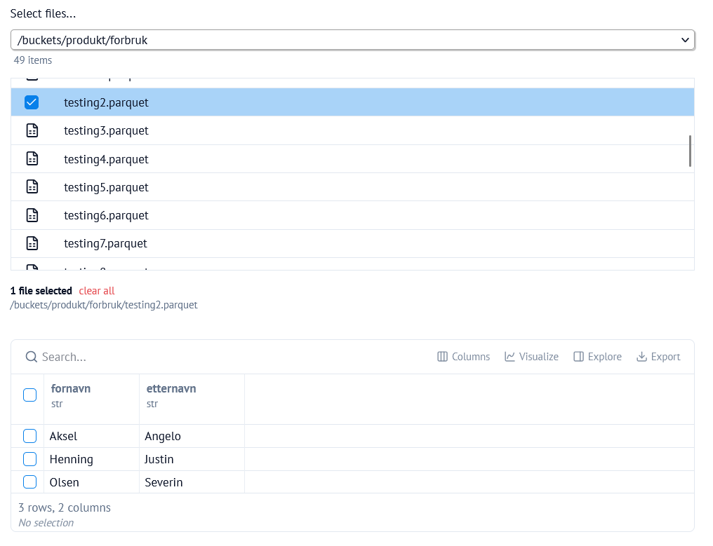

{style="max-width: 350%; float: right;" fig-alt="Marimo dashboard service"}

**Marimo-dashboard** er en tjeneste på [Dapla Lab](./dapla-lab.qmd) som er skreddersydd for utvikling av dashboards og applikasjoner.
Tjenesten bygger på [Marimo](https://marimo.io/), som er et reaktivt Python-miljø med svært god støtte for brukerinteraksjon og dynamiske visualiseringer.

I tillegg kan man bruke [Marimo-studio](https://marimo-team.github.io/marimo-studio/), en utvidelse som gjør det lett å legge til form og stil ved hjelp av vanlig html og css.

Tjenesten er basert på følgende premisser:

* At repoet som klones har en mappe `dashboards/` på rotnivå.
* At `dashboards/`-mappen inneholder Marimo-notebooks med deklarerte pakkeavhengigheter.
  <details>
  <summary>Hva betyr dette?</summary>
  <ul>
  <li>At hver notebook definerer sine egne pakkeavhengigheter i selve filen (se [eksempel](https://peps.python.org/pep-0723/#example)), slik at den kan kjøres isolert fra resten av repoet.</li>
  <li>I praksis trenger man kun å bruke vanlige `import`-uttrykk for å ta i bruk pakker; Marimo vil automatisk foreslå å legge til avhengighetene.</li> 
  </ul>
  </details>

## Forberedelser

Før man starter **Marimo** bør man ha lest [kapitlet om Dapla Lab](./dapla-lab.qmd) og satt opp Git- og GitHub-konfigurasjonen under **Min konto**. Deretter gjør du følgende:

1. Logg deg inn på [Dapla Lab](https://lab.dapla.ssb.no/)
2. Under **Tjenestekatalog** trykker du på **Start**-knappen for **Marimo-studio**
3. Gi tjenesten et navn
4. Åpne **Marimo-dashboard konfigurasjoner**

## Konfigurasjon

Mye av konfigurasjonen for **Marimo-dasboards** er lik det som gjelder for [Jupyter](./jupyter.qmd#konfigurasjon). Det gjelder blant annet valg av team og tilgangsgruppe, Git/GitHub, ressurser, diskplass og avanserte valg som Parquedit-støtte.

Det viktigste som er spesifikt for Marimo ligger under tjenestedelen:

Bilde

### Modus

* Edit-modus brukes når man utvikler et dashboard, det vil si skrive kode i Marimo-grensesnittet. 
* App-modus brukes når man vil starte et dashboard som en selvstendig applikasjon, uten å vise verken kode eller Marimo-grensesnittet. 

### Dashboard-repo

Man kan oppgi et GitHub-repo som skal klones ved oppstart av tjenesten.
Hva som forventes av repoet avhenger av modusen:

* I edit-modus forventes ingenting, og man kan selv opprette `dashboards/`-mappen første gang man åpner repoet.
* I app-modus forventes en eksisterende `dashboards/`-mappe med én eller flere Marimo-notebooks.

Dersom Github-repo ikke oppgis vil det opprettes et tomt prosjekt.


### Marimo-studio

Marimo-studio er en utvidelse til Marimo som kan skrus på dersom man ønsker å lage sine egne *views* med html og css, slik at man får mer kontroll på utseendet til den ferdige applikasjonen.

Marimo-studio kan aktiveres med begge moduser og ha følgende effekt:

* I edit-modus vil Marimo ha en ekstra knapp for å legge til et *view*.
* I app-modus vil Marimo prøve å åpne et tilhørende view dersom det finnes (ellers åpnes standard Marimo-visning).

## Bruksmoduser

### Edit-modus

I denne modusen åpnes tjenesten med hele Marimo-grensesnittet, slik at man kan utvikle og redigere notebook-filer direkte i nettleseren.

### App-modus

Dette passer når man allerede har laget en ferdig notebook-fil som skal vises som et brukergrensesnitt, for eksempel for utforsking av data eller deling av resultater internt i et team.

Hvis målet er å utvikle selve filen, er det normalt best å starte i edit-modus. Før man bruker app-modus er det lurt å sjekke at notebooken lar seg kjøre i edit-modus.

### Marimo-studio

For å ta i bruk Marimo-studio, starter man tjenesten i edit-modus med Marimo-studio skrudd på. Deretter følger man disse stegene:

1. Åpne en eksisterende notebook i mappen `dashboards/` eller lag en ny notebook.
1. Klikk på "Create view" øverst til høyre.
2. Velg "Html" og klikk Create view. Det er kun Html som støttes.
3. 

## Data og Git/GitHub

Marimo følger samme mønster som de andre utviklingstjenestene i Dapla Lab:

1. Datatilgang styres av hvilket team og hvilken tilgangsgruppe du velger.
2. Teamets bøtter blir tilgjengelige i filsystemet under `/buckets/`.
3. Git-bruker, e-post og GitHub-token kan arves fra **Min konto** i Dapla Lab.

For detaljer om datatilgang, delt-bøtter, Git/GitHub, ressurser, diskplass og oppstartsskript, se [Jupyter-kapitlet](./jupyter.qmd#konfigurasjon).

## Datatilgang

Dersom man vil utvikle dashboards med mulighet for å utforske og visualisere data, er et godt startpunkt å legge til en `file_browser`-komponent:

{style="max-width: 80%; margin: 1rem;" fig-alt="Marimo file browser"}


Opprett filutforskeren i en egen kodecelle og konfigurer etter behov:
```py
import marimo as mo

file_browser = mo.ui.file_browser(
    initial_path="/buckets/",
    filetypes=["parquet"],
    selection_mode="file",
    multiple=False,
)
file_browser
```

Den valgte filen kan nå hentes fra variabelen `file_browser` og for eksempel brukes til å vise en tabell:

```py

import polars as pl

selected_files = file_browser.value
if len(selected_files) > 0:
    df = pl.read_parquet(selected_files[0].path)
    output = mo.ui.table(df)
else:
    output = mo.md("Ingen fil er valgt.")
output
```

En slik applikasjon vil være gjenbrukbar på tvers av team, ettersom man vil se de bøttene man har tilgang til og konfigurert ved oppstart av tjenesten. Videre er det reaktivt, alle celler som benytter seg av variabelen `file_browser` vil oppdateres når brukeren endrer filvalg.


## Installere pakker

Marimo-dashboard-tjenesten skiller seg fra Marimo-tjenesten ved at den ikke tar i bruk Python-miljøet i prosjektet.

I stedet er tjenesten ment for å jobbe på frittstående notebooks i dashboards/-mappen av prosjektet.
Tanken er at disse filene lett kan deles og reproduseres uavhengig av Python-miljø.

I praksis betyr dette at man ikke forholder seg til en `pyproject.toml`-fil i denne tjenesten, men heller definerer avhengigheter direkte i notebook-filene. Man trenger i de fleste tilfeller ikke å gjøre noe spesielt; når man importerer pakker i koden, så vil Marimo automatisk foreslå å installere avhengigheter:

Avhengighetene vil da deretter legges inn i filen slik at man ikke trenger å gjenta prosessen neste gang man åpner tjenesten.

Avhengighetene blir lagt inn som en kommentar på toppen av notebook-filen following en Python-standard:

## Lagring av arbeid

Kode bør lagres i GitHub og data bør lagres i bøtter. Filer som bare ligger lokalt i tjenesten kan gå tapt hvis tjenesten slettes, og filer utenfor `$HOME/work` slettes når tjenesten pauses.

For å lagre endringer til Github må man åpne en terminal i Marimo. Dette gjøres enten med tastatursnarveien `Ctrl/Cmd + j` eller ved å trykke på knappen:


Følg deretter stegene beskrevet i:


## Slette tjenesten

For å slette tjenesten kan man trykke på **Slett**-knappen i Dapla Lab under **Mine tjenester**. Når man sletter en tjeneste, slettes også filsystemet i tjenesten og ressursene frigjøres. Hvis du har installert pakker lokalt i tjenesten, må disse installeres på nytt neste gang.

## Pause tjenesten

Man kan pause tjenesten ved å trykke på **Pause**-knappen i Dapla Lab under **Mine tjenester**. Når man pauser tjenesten, slettes alt på den lokale disken som ikke er lagret under `$HOME/work`.

## Monitorering

Man kan monitorere en instans av Marimo ved å trykke på tjenesten under **Mine tjenester** i Dapla Lab. Derfra kommer man til overvåkningssiden for tjenesten, med lenker til teknisk informasjon og eksternt dashboard på samme måte som for andre tjenester i Dapla Lab. Se [monitorering i Dapla Lab](./dapla-lab.qmd#monitorering).
