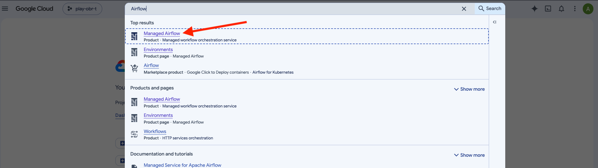
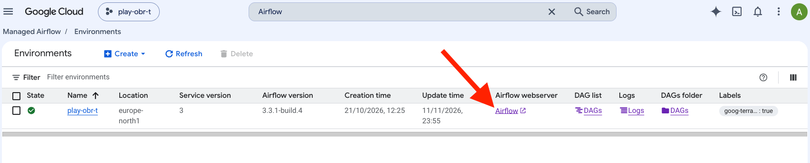

::: {.callout-warning}
## Under arbeid
:::

Statomaten er en tjeneste som lar Dapla-team automatisere hele eller deler av et statistikkløp. Teamet beskriver arbeidsflyt i en Python-fil som kalles en **DAG** (Directed Acyclic Graph). Disse filene legges i teamets IaC-repo hvor de vil automatisk bli lastet opp til Statomaten.

Teknologien Statomaten baserer seg på heter Airflow. Se [Airflows dokumentasjon](https://airflow.apache.org/docs/apache-airflow/stable/index.html) for grundigere informasjon og om alt man kan gjøre i en DAG.

## Hvem kan bruke Statomaten?

Statomaten vil i første omgang kun være tilgjengelig for utvalgte team.

## Forberedelser

Før teamet tar i bruk Statomaten, bør teamet avklare:

- hvilke oppgaver teamet vil automatisere, og hvilke data arbeidsflyten skal lese og skrive
- om arbeidsflyten skal kjøre automatisk til gitte tidspunkter eller startes manuelt
- hvordan teamet skal kontrollere at resultatet er riktig
- hvem som skal vedlikeholde arbeidsflyten, følge med på kjøringene og håndtere feil

## Sette opp tjenesten

Før teamet kan bruke Statomaten, må tjenesten aktiveres som en *feature* i IaC-repoet.

### Aktiver Statomaten

Følg [oppskriften for å aktivere en feature](./features.qmd#aktivere-feature), og legg til `statomaten` under `features` for miljøet som skal bruke tjenesten.

```{.yaml filename="./infra/projects.yaml" caption="Eksempel: Statomaten aktivert i testmiljøet" code-line-numbers="true"}
team_uniform_name: play-obr

projects:
  - project_name: play-obr
    env: prod
    features:
      - dapla-buckets
      - statomaten

  - project_name: play-obr
    env: test
    features:
      - dapla-buckets
```

### Mappestruktur

For å bruke Statomaten må det opprettes en bestemt mappestruktur i IaC-repoet til teamet. I den eksisterende mappen `/automation` oppretter man mappen `/statomaten/<team-navn>-<miljø>/dags`. F.eks. vil mappestrukturen for **prod**-miljøet se slik ut for team **dapla-example**:

```{.yaml filename="github.com/statisticsnorway/dapla-example-iac"}
dapla-example-iac
├── automation/
│   ├── source-data/
│   └── statomaten/
│       └── dapla-example-prod/
│           └── dags
│               ├── example_dag.py
│               └── test/
│                   └── example_dag_test.py
│...
```
I mappen `statomaten/dapla-example-prod/dags` ligger DAG-filene. De tilhørende testene ligger i `statomaten/dapla-example-prod/dags/test`. 

## Ta i bruk tjenesten

### Lage DAGs

En DAG består av oppgaver som skal utføres og reglene for når de skal kjøres. Oppgavene kan for eksempel hente data, kontrollere data, utføre behandling, eller varsle ved problemer. Hvis en oppgave er avhengig av en annen, starter den først når den forrige oppgaven er ferdig.

DAG-filene lagres i teamets IaC-repo under `automation/statomaten/<team-navn>-<miljø>/dags/`:

1. Opprett en branch i teamets IaC-repo, og gjør endringen der.
2. Opprett en pull request, og få endringen godkjent av en data-admin.
3. Kontroller at testene i PR-en ikke feilet.
4. Merge endringen til `main`.

Når endringene merges til `main`, vil filene automatisk bli lastet opp til Statomaten. Deretter kjører Statomaten arbeidsflytene etter planen som er angitt i koden, eller når noen starter dem manuelt.

For detaljert informasjon om hvordan man skriver DAG-er, se [Airflows dokumentasjon om DAGs](https://airflow.apache.org/docs/apache-airflow/stable/core-concepts/dags.html) og [Airflows dokumentasjon om tasks](https://airflow.apache.org/docs/apache-airflow/stable/core-concepts/tasks.html).

::: {.callout-warning}
## Kode i eget statistikkrepo
Det er mulig å referere til pythonkode i andre repoer enn i IaC-repoet. Vær oppmerksom på at denne metoden ikke respekterer avhengigheter, altså det som er i repoets `.lock`-fil.

<TODO - eksempel-kode>
:::

#### Planlegg arbeidsflyten

Teamet kan planlegge at en arbeidsflyt skal kjøre automatisk på et fast tidspunkt, eller sette den opp slik at den startes manuelt. Dette defineres i DAG-en.

En plan angir hvor ofte Statomaten skal starte arbeidsflyten, men garanterer ikke at den starter på sekundet. Tenk gjennom hvilken dataperiode hver kjøring skal behandle. For en daglig arbeidsflyt bør dataene for perioden vanligvis være klare før kjøringen starter.

I DAG-koden kan teamet for eksempel bruke `schedule="@daily"` for å angi en daglig plan. For flere alternativer, se [Airflows dokumentasjon om planlegging](https://airflow.apache.org/docs/apache-airflow/stable/authoring-and-scheduling/index.html).

#### Tester

Teamet kan skrive tester for DAG-ene for å sikre at de fungerer som forventet. Testene legges i mappen `automation/statomaten/<team-navn>-<miljø>/dags/test/` og kjøres automatisk når teamet oppretter en pull request.

For eksempler på hvordan man skriver tester for DAG-er, se [Airflows dokumentasjon om best practices for testing](https://airflow.apache.org/docs/apache-airflow/stable/best-practices.html).

### Grafisk grensesnitt

Statomaten har et grafisk grensesnitt i Airflow:

1. Gå til Google Cloud-konsollen, og velg Google-prosjektet som inneholder Statomaten-miljøet, fra prosjektvelgeren øverst til venstre.
1. Søk etter «Airflow» i søkefeltet øverst på siden, og velg «Managed Airflow» i søkeresultatene.

   {#fig-statomaten-search-airflow}

1. Klikk på lenken «Airflow» i kolonnen «Airflow webserver». Hvis du får spørsmål om å logge inn, gjøres dette med vanlig ssb-konto.

   {#fig-statomaten-airflow-webserver-link}

I grensesnittet kan teamet følge med på arbeidsflytene, kontrollere status på kjøringer og undersøke kjøringshistorikk og logger ved feil.

### Data og tilganger

Statomaten setter opp en tjenestekonto med tilgang til teamets kilde- og standardbøtter. Arbeidsflyten kan bare lese og skrive data som denne kontoen har tilgang til.

### Nettverksåpning for utgående trafikk

Statomaten kjører i et eget internt nettverk for teamet. Hvis arbeidsflyten må nå eksterne kilder, for eksempel API-er, må teamet søke om nettverkstilgang via Kundeservice.

Når teamet sender en søknad, bør følgende informasjon være med:

- Hvilke URL-er trenger dere åpning til?
- Er maskinporten vurdert?

Dette gjør det raskere og lettere å behandle søknaden.

### Python-versjoner

Statomaten kjører med **Python 3.11** som standard. Hvis arbeidsflyten krever en annen Python-versjon, kan teamet overstyre dette ved å bruke et eget Python-image. 

1. Lag en `pyproject.toml` fil i teamets IaC-repo under mappen `automation/statomaten/<team-navn>-<miljø>/`. Denne filen forteller Statomaten hvilken Python-versjon og Python-pakker som skal brukes. For eksempel:
  ```{.toml filename="automation/statomaten/dapla-example-prod/pyproject.toml"}
  [project]
  name = "statomaten-example"
  version = "0.1.0"
  requires-python = ">=3.12"
  dependencies = [
      "pandas==2.0.0",
      "requests==2.31.0",
  ]
  ```
  Bytt `3.12` med ønsket Python-versjon, og legg til de Python-pakkene teamet trenger i `dependencies`-listen.

2. Opprett en PR 
  Når teamet pusher `pyproject.toml` til `main`-branchen, startes en byggejobb automatisk. Denne jobben:

  - Bygger et Docker-image basert på Python-versjonen og pakkene teamet har spesifisert
  - Laster imaget opp til teamets Docker-register i Google Cloud (Artifact Registry)
  - Gjør imaget tilgjengelig for arbeidsflyten

  Jobben tar vanligvis noen minutter.

3. Bruk bildet i arbeidsflyten

  Når bildet er klart, kan teamet bruke det i DAG-filen ved hjelp av `KubernetesPodOperator`. Her er et eksempel:

```{.python filename="automation/statomaten/dapla-example-prod/dags/example_dag.py"}
import datetime
from airflow import models
from airflow.providers.cncf.kubernetes.operators.pod import KubernetesPodOperator

with models.DAG(
    dag_id="example_custom_python_dag",
    schedule=None,
    start_date=datetime.datetime(2024, 1, 1),
) as dag:
    task = KubernetesPodOperator(
        task_id='run_python_script',
        image="europe-north1-docker.pkg.dev/artifact-registry-5n/dapla-example-docker/automation/composer/python:latest",
        cmds=['python3'],
        arguments=['script.py'],
    )
```

Erstatt `dapla-example` i `image="europe-north1-docker.pkg.dev/artifact-registry-5n/dapla-example-docker/automation/composer/` med ditt teams navn.
